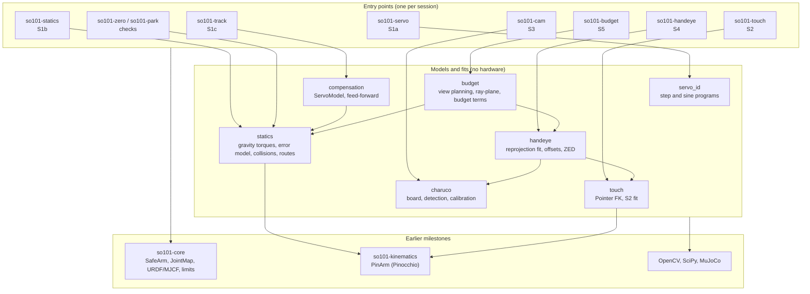
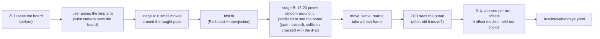
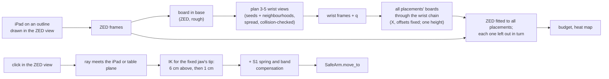

# so101-calib design

Why this package looks the way it does, how its parts fit together, and which parts matter most. State as of
2026-11-07, end of M2. Results are in the [README](../README.md); the theory behind each method is in
[THEORY.md](THEORY.md); the decision log, with dates and the options weighed, is
[DECISIONS.md](../DECISIONS.md).

## 1. What it is for

M2 of the SO-101 series. It sits on [so101-core](https://github.com/hujunhan/so101-core) (M0: robot model,
units, joint map, safe hardware access) and [so101-kinematics](https://github.com/hujunhan/so101-kinematics)
(M1: Pinocchio forward kinematics and IK). M1 ended with two open problems: the servos lag and sag, and the
model disagrees with the arm (10 cm on the table read as 8.66 cm). M2 answers:

1. **How do the servos follow a command, and can we correct for it?** (S1: identification, a static model,
   feed-forward.)
2. **Where are the cameras?** (S3: intrinsics; S4: the wrist camera on the gripper, the ZED in the base frame.)
3. **How wrong is the arm's model, and can it be fixed?** (S2 tried touches and stopped; S4 measured the joint
   zeros with the camera; the elbow was 7.3 deg off and is now in so101-core's joint map.)
4. **How far is a point picked in the ZED image from where the tool goes, and why?** (S5: error budget, demo.)

It deliberately does **not** record demonstrations or learn (M3), and does not plan grasps (M5). What it hands
to them is a set of YAML files (section 8).

## 2. Design goals

| Goal | What it means in the code |
|---|---|
| **Measure, then model, then check on data the model did not see** | Every model is chosen by a held-out test: k-fold over views, leave one run or placement out, a payload run for the servo model, a second run for the offsets. The fitted error is never the argument. |
| **The user's time is the scarce resource** | Few, simple physical steps: the iPad shows the targets (no printing); views are taken automatically; poses are planned, not taught one by one; one taught pose per hand-eye run. |
| **Hardware only through `SafeArm`** | Every motion goes through so101-core's safety filter (limits, step cap, stall watch). Every powered command first prints a plan and preflight, asks for `yes`, and asks for Enter before releasing torque. Plans are collision-checked in MuJoCo, with the iPad as a box. |
| **Pixels are the measurement** | Camera fits minimize reprojection error over every corner; closed forms (Zhang, Park) only start them. |
| **Physics in the model** | The servo model is a spring plus a friction band with URDF torques, not a lookup table; the board is flat on the table; one table height for all placements. Constraints remove what the data cannot tell apart. |
| **Testable without hardware** | Each fit is tested on synthetic data with known answers (camera, hand-eye with offsets, two placements, ZED from placements, leave-one-out); planners are tested offline. 44 tests, no hardware. |
| **Public repo** | Raw images (they show the room) stay in the git-ignored `captures/`; `results/` holds numbers, reports and reviewed plots. No serial numbers. |

## 3. Architecture

### 3.1 Layers



Library modules hold models and fits and never touch hardware; each `*_cli.py` holds one session's hardware
flow (plan, run, fit/analyze). The split lets every fit run in tests and on saved data.

### 3.2 What each session reads and writes

| Session | Reads | Writes |
|---|---|---|
| S1a `so101-servo` | the arm | `results/s1/servo_*.npz/.md/.png` |
| S1b `so101-statics` | the arm | `results/s1/statics_*.npz/.md/.png` |
| S1c `so101-track` | S1b runs | `results/s1/servo_model.json`, `track_*` |
| S2 `so101-touch` | the arm, iPad dot grid | `results/s2/touch_*` |
| S3 `so101-cam` | cameras, iPad ChArUco | `captures/s3/` (images), `results/s3/*_intrinsics.yaml` |
| S4 `so101-handeye` | arm, both cameras, S3 | `captures/s4/` (images, joint angles), `results/s4/handeye.yaml` |
| S5 `so101-budget` | arm, both cameras, S1, S3, S4 | `captures/s5/`, `results/s5/` (report, heat map) |

## 4. Data flow

### 4.1 S4: from a taught pose to the camera, the board and the offsets



Joint angles are stored with the joint map's offsets of the time, and the fit converts them back to LeRobot
readings. So `handeye.yaml`'s offsets are always the whole zero error, whatever the joint map held when a run
was taken; code working on `SafeArm` angles adds only the difference (`Calib.extra` in `budget_cli`).

### 4.2 S5: from placements to a budget, and from a click to the tool



### 4.3 Protection before and during motion

1. **Plan and preflight, offline**: every route is the exact sequence of commands `move_to` will send; each is
   checked in MuJoCo (arm self-collision, the floor plane, the iPad box with a margin) and for the tool's height
   above the board. A failing preflight stops the run before torque goes on.
2. **Ask**: `yes` before torque, Enter before releasing it (the user supports the arm).
3. **so101-core's filter**: limits (now reading-aware), a step cap per command, stall detection.
4. **Settling**: views are taken after the arm settles and the joints are read (mean of 10 reads), with a frame
   newer than the reads.

## 5. Key pieces

### 5.1 The servo model (`statics`, `compensation`)

`error = c * tau + side * (b + k |tau|) + o` per joint, `tau` from Pinocchio's gravity on the URDF masses (plus
an optional payload). Fitted on 16 poses x 5 joints x 2 sides, it is the input to feed-forward (S1c) and to the
demo's stop (S5). It is a physical model on purpose: it transfers to loads and poses it did not see.

### 5.2 The hand-eye fit (`handeye.fit`)

One function covers every variant used: offsets of any joint set (`MODELS`), one board per run, flat boards,
one shared height (or a given one), and a fixed camera with only the boards free (to test X and the offsets
on a run they were not fitted on). `heldout_px` and `other_run_px` wrap it for model choice; `zed_fit` fits
the ZED to several placements. The arm's FK is Pinocchio's (`touch.Pointer`), the same model M1 uses.

### 5.3 View planning (`budget.plan_views`, `handeye_cli.plan_stage_b`)

Good wrist views are a thin slice of joint space: the board must be inside the image and not under the jaws
(`handeye.under_jaws`), seen within 40-50 deg of face-on from 18-35 cm, with the gripper well clear of the
iPad. Uniform random sampling finds few; S5 seeds with uniform samples and searches their neighbourhoods,
then farthest-point sampling over the camera's pose keeps the most different ones, ordered for short moves. A
pose whose move touches something leaves the pool and the choice is made again.

### 5.4 The board on the iPad (`charuco`, `tools/`)

The board image is generated by OpenCV at the iPad's pixel pitch and embedded in a page
(`tools/ipad_charuco.html`) that shows it pixel for pixel. Detection refines missed markers
(`tryRefineMarkers`: 10.7 -> 19.8 of 20 markers with glare and the gripper in view) and rejects collinear
corner sets. The iPad must be dimmed (~50 %) or the ZED, exposing for the room, saturates it.

### 5.5 Reading-aware limits (so101-core `JointMap.model_limits`)

With a zero offset in the joint map, the model angle and the LeRobot reading differ. The safety limits are
the intersection of both ranges, so the offset can never let a joint be commanded past the range it was
calibrated over. Added to so101-core in M2 because the first version of the offset would have let the elbow's
reading reach 99 deg against a 96.6 deg range.

## 6. Design decisions and rejected alternatives

| Decision | Why | Rejected |
|---|---|---|
| Servo gain P = 32 for M2 | halves the gravity error and shrinks the band 2-4x; no oscillation at rest, no heating | LeRobot's 16 ("to avoid shakiness": not seen here) |
| A physical servo model (spring + load-dependent band) | transfers to a payload it did not see (0.84-0.91 -> 0.14-0.21 deg) | per-pose lookup; a single sag number (M1) |
| Stop S2 (touches) | residual random per touch (3.5 mm), pointer slid 8.7 mm between runs; hand forces bend the arm | more touches; teleop touches (tried twice) |
| iPad as the target, pixel exact | no printer; exact and flat; one board for S2-S5 | printed board; rigid board (not available) |
| ZED over UVC with its factory calibration | the path M3's recordings use; factory parameters predict our data as well as our own fit | the ZED SDK (closed, multi-GB, CUDA) |
| Hand-eye by reprojection, Park only as a start | pixels are the measurement; joint offsets fit in the same model | closed forms alone (Tsai, Park, Daniilidis) |
| ZED through the shared board | no marker on the gripper; the board's base pose is known from the wrist | gripper marker seen by the ZED |
| Keep only the elbow offset | as good as three offsets on a left-out run, and known to 0.1 deg; lift and wrist trade with the camera mount | all three offsets (first run's choice) |
| Offset into so101-core's joint map | every later program gets the corrected model; LeRobot's calibration and datasets unchanged | recalibrating LeRobot (the same asymmetric range gives the same zero) |
| One table height for all placements | the same iPad on the same table; a placement seen from 2 poses had drifted 8-10 mm | a height per placement |
| Demo aims the fixed jaw's tip | a point one can see and measure to | the URDF tool frame (6 mm inside the jaw) |
| Demo uses S4's ZED pose | the wide S5 run's boards are pulled by far poses (the ZED fit to them is 4.6 px) | S5's refit |
| Error terms combined as a root sum of squares | simple and conservative when terms correlate | Monte Carlo over all parameters |

## 7. File by file

### Library (`src/so101_calib/`)

| File | Role |
|---|---|
| `servo_id.py` | S1a: step and sine test programs, their analysis, `ramp_path` (the commands `move_to` sends) |
| `statics.py` | S1b: gravity torques (`Gravity`), the static error model and its fit, MuJoCo `Collisions` with world boxes, `route` |
| `compensation.py` | S1c: `ServoModel` (fit, save, load), `compensate`, the virtual servo |
| `touch.py` | S2: `Pointer` (gripper-frame FK on Pinocchio, used by S4 and S5 too), the touch fit, its simulation |
| `charuco.py` | S3: the board, detection, `Intrinsics`, `calibrate`, cross-validation, the ZED factory file |
| `handeye.py` | S4: the reprojection fit, offset models, held-out and left-out-run tests, predicted views, jaw mask, `zed_fit` |
| `budget.py` | S5: view planning, ray-plane, leave-one-placement-out, mm per pixel, the servo term |

### Entry points

| File | Command | Hardware |
|---|---|---|
| `servo_cli.py` | `so101-servo plan / run / analyze` | powered |
| `statics_cli.py` | `so101-statics plan / run / preview / analyze` | powered |
| `track_cli.py` | `so101-track model / plan / run / analyze` | powered |
| `touch_cli.py` | `so101-touch plan / record / push / fit` | limp or teleop |
| `cam_cli.py` | `so101-cam board / capture / calibrate` | cameras only |
| `handeye_cli.py` | `so101-handeye zed-view / run / fit` | powered |
| `budget_cli.py` | `so101-budget plan / run / fit / point` | powered |
| `zero_cli.py` | `so101-zero plan / run`: the model zero and LeRobot's, to check the elbow offset by eye | powered |
| `park_cli.py` | `so101-park plan / test / approach`: holding still and moving to rest, read densely | powered |

### Tests, results, tools

- `tests/`: synthetic-data tests of every fit with known answers, plus planners and parsers (44 tests).
- `results/s1..s5/`: numbers, reports, plots; `results/s4/handeye.yaml` is the main product.
- `tools/ipad_charuco.html`, `tools/ipad_grid.html`: the iPad pages (also published as artifacts).
- `captures/` (git-ignored): raw images and joint angles of S3-S5.

### If you read only three files

`statics.py` (the servo model), `handeye.py` (the camera and joint calibration), `budget.py` (from a pixel to
a point, and how wrong that is).

## 8. How later repos use it

```python
import numpy as np, yaml
from so101_core.arm import SafeArm      # the joint map already holds the elbow offset

h = yaml.safe_load(open("results/s4/handeye.yaml"))
X = np.array(h["T_gripper_wristcam"])    # wrist camera in the gripper (wrist_roll) frame
Z = np.array(h["T_base_zed_left"])       # ZED left eye in the base frame
table_z = h["table_z_m"]                 # the table's height in the base frame

# a pixel (u, v) of the ZED's left eye (1280 x 720, factory intrinsics) -> a point on the table:
from so101_calib.budget import ray_plane
from so101_calib.handeye_cli import zed_left
p = ray_plane(np.array([[u, v]]), zed_left(), Z, table_z)[0]
```

- **M3** records through LeRobot, whose readings are unchanged; the joint map's offset matters where M3 uses
  so101-core's kinematics (twin, evaluation). The ZED and wrist camera poses let images be related to the arm.
- **M5** (classical pipeline) uses the whole chain: ZED pixel -> ray -> table point -> IK -> compensated
  command. The budget says what to expect: ~1-2 mm per term near the calibrated region, more in far poses.
- The servo model (`results/s1/servo_model.json`, `compensation.ServoModel`) applies to any static target.

## 9. Known limits and open items

- **The arm's model is several mm off in far poses** (shoulder folded far back, camera sideways): offsets, link
  lengths, joint compliance and a roll error do not explain it; a camera-mount tilt explains part. Measured in
  S5 with wide wrist views; the working region was not measured separately.
- **The demo was not measured with a ruler**; the joints put the tip within 0.6 mm of the target, and by eye it
  sat on the clicked corner.
- **The ZED pose** is from S4's two placements; it holds only while neither the ZED nor the arm moves. The
  workspace is being rebuilt (light box, backdrop): re-locating the ZED is `so101-handeye relocate` (one board placement, S4's camera mount; README).
- The demo refuses moves whose straight joint path dips within 2 cm of the table; a lift between points would
  fix it.
- Moving to rest, the shoulder oscillates ~0.1 deg near zero gravity load; holding still is exact. The
  standing park pose (`so101-park`) is not used by the tools.
- Wrist intrinsics: the left image corners had few views (ray direction ~1.5-3 deg uncertain there).
