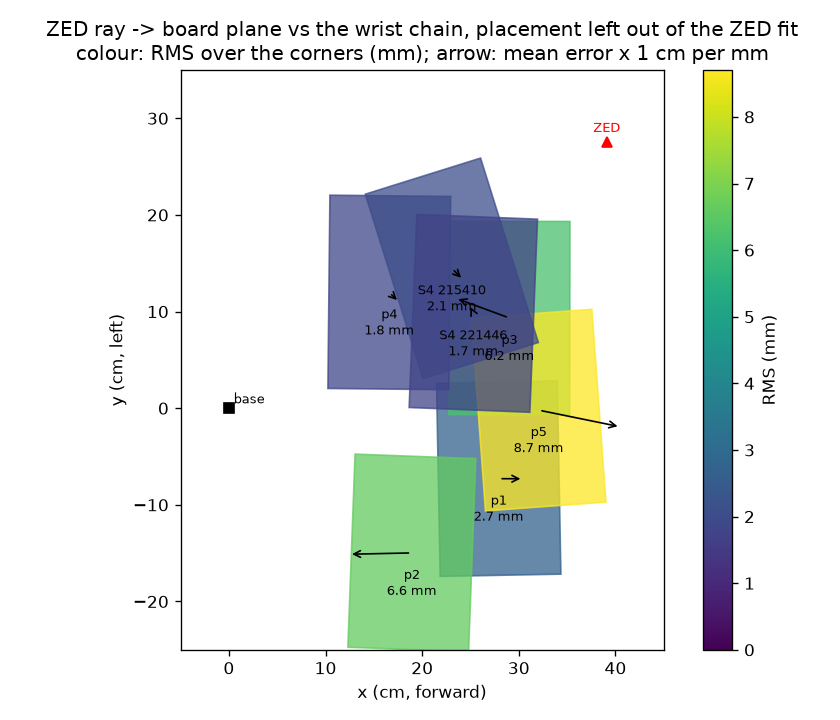

# S5 error budget: p1, p2, p3, p4, p5, S4 215410, S4 221446

7 placements of the board. The ZED (left eye) refitted to all of them: [39.1, 27.6, 37.1] cm, looking along [-0.46, -0.11, -0.88] (4.59 px).

Per placement: the ZED's ray through each corner meets the board's plane; the point is compared with the corner as the wrist chain (S4's camera and elbow offset) puts it. Left out: the ZED fitted without this placement.

| Placement | Board centre (cm) | Wrist views | Wrist fit (px) | ZED corners | mm per ZED px | Left out: RMS / max (mm) | Mean error x, y (mm) | All in: RMS (mm) |
|---|---|---:|---:|---:|---:|---|---|---:|
| p1 | (27.9, -7.3) | 2 | 9.34 | 82 | 0.88 | 2.71 / 3.76 | +2.59, -0.01 | 1.78 |
| p2 | (18.9, -15.0) | 5 | 9.81 | 151 | 1.07 | 6.61 / 8.91 | -6.54, -0.14 | 2.60 |
| p3 | (29.0, +9.3) | 4 | 7.22 | 168 | 0.76 | 6.20 / 7.73 | -5.62, +2.07 | 4.22 |
| p4 | (16.6, +12.0) | 5 | 3.84 | 168 | 0.92 | 1.84 / 3.06 | +1.04, -1.03 | 0.79 |
| p5 | (32.1, -0.2) | 4 | 19.97 | 168 | 0.78 | 8.70 / 9.30 | +8.51, -1.73 | 5.85 |
| S4 215410 | (23.1, +14.5) | 15 | 4.99 | 106 | 0.82 | 2.06 / 3.26 | +1.20, -1.23 | 1.61 |
| S4 221446 | (25.3, +9.8) | 19 | 3.75 | 73 | 0.81 | 1.73 / 3.77 | -0.46, +0.94 | 1.59 |

## Budget for pointing at a clicked ZED pixel (tool 1 cm above the board)

| Term | How measured | RMS (mm) |
|---|---|---:|
| ZED pixel: a click 1 px off | mean mm per px over the placements x 1 px | 0.86 |
| ZED pose (and the wrist chain's board) | ZED ray-plane error, placement left out of the fit | 5.49 |
| Arm kinematics after the elbow offset | board centre seen from each wrist pose vs the placement's fit | 3.09 |
| Servos, compensated (S1) | 0.15 deg per joint at the pointing poses | 1.12 |
| **Total** (root sum of squares) | | **6.46** |

Servos without compensation (plain `move_to`): 6.2 mm RMS at the same poses (S1b's sag and dead band).

Table at -2.8 mm in the base frame (board - 11 mm).

